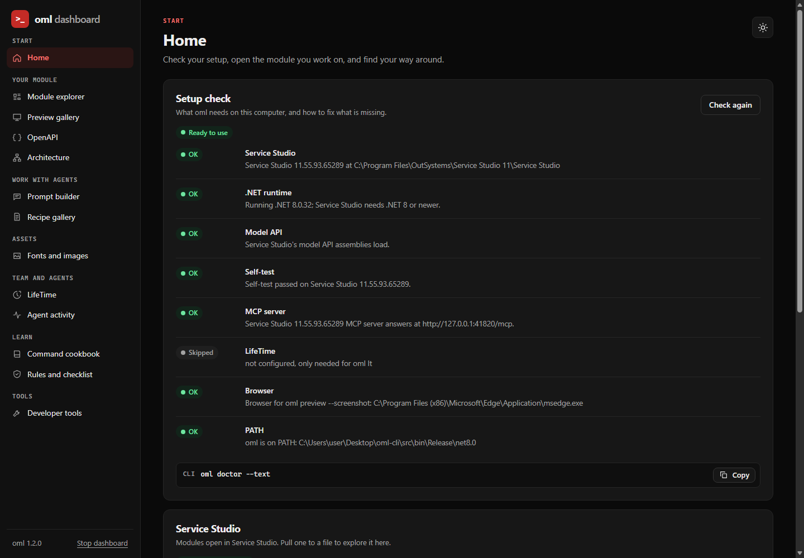

# oml

`oml` is a command-line tool for OutSystems 11. It reads and changes `.oml` modules through the typed Model API of your installed Service Studio. It never edits OML XML.

You describe a change in a JSON spec, apply it to a new staged file, check it, and then install it. You can use `oml` yourself, or give its skill to an AI agent.

Website: [topurrra.github.io/oml-cli](https://topurrra.github.io/oml-cli/) · [Releases](https://github.com/Topurrra/oml-cli/releases) · [Changelog](CHANGELOG.md)

## Dashboard

Not a terminal person? `oml dashboard` opens a local web page with the same tools.



*Screenshot: `docs/dashboard.png`, the Home page in the dark theme.*

Start it with `oml dashboard`, or double-click `oml-dashboard.cmd` next to `oml.exe`. It opens your browser; keep its window open, and press Ctrl+C there to stop it. `--port N` picks the port, `--no-open` does not open the browser, and `--module <file.oml>` opens that module in the Module explorer.

What it can do: check your setup (`doctor`), get modules into a working set (copied from Service Studio, from a folder or an `.oap`, dropped, or downloaded from LifeTime), browse a module and read what each element does (`inspect`, `describe`, `find`, `find --text`, `tree`, `validate`), run `oml check` and `oml review` with their HTML reports, search the docs, spec and warnings (Ctrl+K), make a test spec for a public server action, show previews of every screen and block in light and dark, build a clear task for an AI agent, browse the recipes, convert fonts and images, export and fill in OpenAPI files, make architecture pages, read LifeTime (also download an application's `.oap`, and team architecture and check pages), show what agents ran (usage log), and a set of small developer tools (JSON, Base64, JWT, regex, colour contrast, ...). Every action shows the CLI command, with a copy button.

Security: it listens on 127.0.0.1 only, with a random key in its address that every request must send; other sites cannot call it.
It only reads: it never installs, publishes, refreshes references, or tags or deploys in LifeTime, and the LifeTime token stays in the environment, never in the page.

## Right-click in Explorer

`oml setup` adds right-click entries to Windows Explorer for your user (no admin rights needed):

- On a font (`.ttf`, `.otf`, `.woff`): **oml: Convert to WOFF2**.
- On an image (`.png`, `.jpg`, `.jpeg`, `.webp`, `.gif`, `.bmp`, `.svg`): **oml: Optimize image** (WebP for raster images, a smaller SVG for SVG) and **oml: Convert to ICO** (16, 32 and 48 pixels).
- On a raster image (not `.svg`): **oml: Trace to SVG** (vector paths, for logos and icons).
- On an `.oml` file: **oml: OpenAPI** and **oml: Open in dashboard**.
- On a folder: **oml: Convert all fonts to WOFF2**, **oml: Optimize all images** (into a new subfolder) and **oml: Architecture report**.

On Windows 11, choose "Show more options" first. Results are written next to the file and never replace a file; Explorer then shows them. If something fails, a message box says why, and `%LOCALAPPDATA%\oml-cli\setup.log` keeps a line per run.
`oml setup --status` lists the entries, and `oml setup --remove` removes exactly what `oml setup` added. Run `oml setup` again after you move `oml.exe`, and run `oml setup --remove` before you delete it. A console window may flash for a moment when an entry starts. Each "Open in dashboard" starts a new dashboard window. Details: [commands.md](skill/reference/commands.md#explorer-right-click-entries).

## What it covers

| Area | What `oml` does |
|---|---|
| Build and change | One JSON spec for entities, static entities, CRUD actions, server/service/client actions, flows, aggregates with joins, SQL, REST, screens and blocks (Reactive, Mobile, Traditional Web), timers, roles, processes, translations and resources. New flows are laid out the way Service Studio does it. Existing screens, blocks, emails and themes take new CSS, and `replaceWidgets` replaces part of a screen, with no rebuild. |
| Read cheaply | `inspect`, `describe` (what an action or screen does, in a few lines), `find` (which module owns an element). Compact JSON output keeps agent token use low. `--history` and `--changed-since` show who changed an element and when. |
| Check UI | `preview` renders a block, screen or email to HTML, runs its scripts and lifecycle JavaScript offline with a stub runtime, takes light/dark and phone-width screenshots (after optional clicks and typing), and runs automatic UI checks. `--serve` shows a live page that reloads when the module changes. |
| Architecture | `architecture` makes one zoomable HTML page from a folder of `.oap`/`.oml` files or a LifeTime team: applications, modules, End-user/Core/Foundation layers, dependencies and findings. |
| Check | `check` finds AI Mentor-like patterns (performance, security, maintainability, architecture) in a module, an application or a team in seconds, with a team rules file, a baseline and an HTML report. A subset of AI Mentor, not a replacement. |
| Review | `review` compares two versions of a module (before and after a change) by the model's own keys, so a rename stays a rename. It lists what changed in plain words (data, logic steps, UI, integrations, roles, settings), the production-rule risks and the new `check` findings, as JSON, Markdown for a pull request, an HTML page or release notes for testers. |
| Memory | `memory` is a project memory for AI agents, so you can change agent or session without explaining the project again. One plain-text file per project (`.oml/memory/memory.log`): decisions, user answers, traps and preferences, one fact per record, with a hash chain that shows edits. Agents recall the best 3 records in their first read call (the same local search as `oml doc --search`, no model, no network). Secrets are refused. Only `oml memory` writes the file. See `oml doc memory`. |
| Library | `library fetch` downloads the OutSystems 11 docs (docs-product, docs-support, docs-howtos; Markdown only, about 15 MB) to your machine. `doc --search "<words>" --library` then answers platform questions: Service Center, LifeTime, servers, network, errors. The docs are CC BY-NC-ND 4.0 (c) OutSystems: oml does not ship them. |
| Company skills | `skills add <file.md>` installs your team's own rules (naming, layers, Confluence pages saved as Markdown). They override oml's OutSystems best practices, never the production rules. `oml doc` lists them, and `oml doc --search` ranks them first. |
| REST | `openapi` exports exposed REST APIs as OpenAPI 3.0.3, with `<FILL:` placeholders for contact, servers and examples. |
| Tests | `test scaffold` writes a spec for BDDFramework test screens of public server actions (Given/When/Then scenarios with TODO test values), to apply to a separate test module. Checked only against a stand-in of BDDFramework. |
| Service Studio and deploy | `pull` saves the module open in Service Studio to a file (no manual export); 1-Click Publish and Refresh All through Service Studio's MCP server; LifeTime API v2 tags and deployments. |
| Packages | List, extract and pack `.oap`/`.osp`; inspect and create `.xif` extensions. |
| Assets | Fonts to WOFF2; convert, resize and shrink images; multi-size ICO files (favicons, app icons); trace a PNG logo or icon to an SVG with real vector paths; SVG optimization that checks every result against the original pixels. `apply` removes comments from CSS and JavaScript (license notices stay). Long code can come from a file: `{ "file": "code/chart.js" }`. |

Full command list: [skill/reference/commands.md](skill/reference/commands.md). All spec keys: [skill/reference/spec.md](skill/reference/spec.md).

## Commands by audience

Developers work in Service Studio. Most commands are for AI agents, so agents can work faster and with fewer tokens.

| Group | Commands | Used by |
|---|---|---|
| Dashboard and Explorer | `dashboard`, `setup` | Developers |
| Converters | `font woff2`, `font batch`, `image`, `image batch` | Developers |
| REST | `openapi` | Developers |
| Architecture | `architecture` | Developers, architects |
| Code check | `check`, `review` | Developers, teams, agents |
| Read a module | `inspect`, `describe`, `find`, `census`, `tree` | Agents |
| Change a module | `new`, `apply`, `spec`, `run`, `install`, `validate`, `translations export` | Agents |
| Knowledge | `doc`, `warn` | Agents |
| UI | `preview` | Agents, sometimes developers |
| Tests | `test scaffold` | Agents |
| Packages | `app list`, `app extract`, `app pack`, `extension inspect`, `extension new`, `templates` | Agents, sometimes developers |
| Service Studio and deploy | `studio`, `pull`, `publish`, `references`, `lt` | Agents; publish and deploy after you confirm |
| Diagnostics | `version`, `selftest`, `doctor`, `log`, `api`, `widgets` | Agents, maintainers |

## Check

`oml check` reads module files and lists code patterns, like AI Mentor does, in a few seconds. Run it on your own module, application or team before you publish:

```powershell
oml check Orders_CS.oml
oml check --in C:\Exports\Payments --out check.html --json check.json
oml check --team Payments --rules oml-rules.json --baseline last-check.json --fail-on high
```

Each finding has a rule id, a severity, a category (Security, Performance, Maintainability, Architecture), the module and element path, what is wrong, how to fix it, and the AI Mentor pattern name when there is one. There are 35 rules. Examples: a query inside a loop, a screen query without a row limit, server calls from client loops and screen events, Expand Inline SQL fed by input, `GetUserId()` sent from the client, secret-looking site properties, public entities that are not read-only, long, deep or duplicated flows, and the `oml architecture` findings when you give several modules.

- `oml check --init-rules` writes `oml-rules.json`. Turn rules on or off, set severities and thresholds so that they match your active AI Mentor rules, and list ignored elements with a reason.
- `--baseline` marks each finding `new` or `existing`; with `--fail-on`, only new findings make the exit code 1.
- It is a subset of AI Mentor, from the module file alone; your CI keeps using AI Mentor. Severities are oml's defaults, because the OutSystems docs publish none. Exposed REST APIs without authentication are not reported unless you turn that rule on (API gateways such as Kong often authenticate).

Rules, coverage and the file formats: [commands.md](skill/reference/commands.md#check).

## Review

`oml review` compares two versions of one module, for example the module and an agent's staged file, and gives a one-page summary to approve:

```powershell
oml review Orders.oml Orders.staged.oml --md review.md --out review.html --notes release-notes.md
```

It matches elements by the model's own keys, so a renamed element is a rename. It says what changed in plain words ("step Audit added after PrepareOrder", "condition Total >= 0 -> Total > 0"), flags production risks with the rule they break (deletes, renames, type or length changes, broken public signatures, data-changing SQL, Anonymous access, new public server actions, unique indexes), and lists only the `check` findings that are new. Logic bugs are not covered; 0 findings does not mean the code is correct. Details: [commands.md](skill/reference/commands.md#review).

## Benchmarks

Same task, same module, same model on both sides. The OutSystems MCP side used Service Studio's MCP server with the official OutSystems skill for O11. Each row is one run, so treat the numbers as a direction, not a guarantee.

**Small task** (an entity, two CRUD actions, a list screen; model `gpt-6-luna`):

| | OutSystems MCP + O11 skill | oml |
|---|---:|---:|
| Result | 0 errors | 0 errors, same content |
| Input tokens | 611,714 | **207,210** (3.0× fewer) |
| Output tokens | 4,474 | **2,780** |
| Time | 185 s | **56 s** (3.3× faster) |
| Tool calls (failed) | 19 (2) | **10 (0)** |

**Large task** (24 UI components, a gallery screen, theme toggle and font picker; model Claude Haiku 5.5; cost as reported by Claude Code):

| | Result | Cost | Time | Turns |
|---|---|---:|---:|---:|
| MCP, 1 agent | 24/24, 0 errors | $0.94 | 787 s | 58 |
| **oml, 1 agent** | 24/24, 0 errors | **$0.55** | **706 s** | **37** |
| MCP, 8 agents + 1 assembly | **20/24**: one agent was blocked, one block was lost in a merge | $3.16 | 968 s | 340 |
| **oml, 8 agents + 1 assembly** | 24/24, 0 errors, 0 warnings | **$1.17** | **700 s** | 267 |

Why: output is similar, because both sides write the same CSS and JavaScript. MCP needs more turns, and every turn reads the context again. Parallel MCP agents all edit the one module open in Service Studio; `oml` agents each work on their own files.

**oml 1.1.0 vs 1.2.0** (the same large task, 1 agent, same module, Haiku 5.5, 3 runs each, averages):

| | Cost | Time | Turns | Result |
|---|---:|---:|---:|---|
| oml 1.1.0 | $0.80 | 864 s | 64 | 24/24, 0 errors |
| **oml 1.2.0** | **$0.36** | **615 s** | **37** | 24/24, 0 errors |

1.2.0 gives agents a fixed loop that batches commands into fewer tool calls. One 1.2.0 run left unexplained warnings, so the skill now requires fixing or explaining every new warning; one run with that rule cost $0.81 with 0 warnings, so the cost with the rule still needs more runs. Re-run any of these with [tests/bench](tests/bench/README.md).

## Install

**Prerequisites:** Windows, Service Studio 11, and the .NET 10 runtime (the SDK to build from source). Service Studio 11.55.94 and later install it. Publishing and reference refresh need Service Studio 11.55.91 or later with its MCP server started (**Edit > MCP Server > Start MCP server**).

**Release:** download `oml-<version>-win-x64.zip` from [Releases](https://github.com/Topurrra/oml-cli/releases), unzip it, keep its folders together, and add `bin` to PATH. Unsigned executables may be blocked by company policy; then build from source.

**From source:**

```powershell
dotnet build -c Release src/OmlCli.csproj
$env:PATH = "$PWD\src\bin\Release\net10.0;$env:PATH"
oml version
```

For a Service Studio folder other than the default, set `OML_SERVICE_STUDIO` and build with `-p:SS="<that folder>"`. On a new Service Studio build, `oml` first runs a short self-test and stops if it fails.

Run `oml doctor` to check your setup.

## Quick start

```powershell
oml inspect App.oml --own --only entities,actions,screens
oml apply App.oml change.json App.staged.oml
oml validate App.staged.oml --warnings
oml describe App.staged.oml ReviewNote
oml install App.staged.oml App.oml
```

`apply` never changes the source file. `install` replaces it only when the staged file has zero validation errors, and keeps a backup. A minimal `change.json`:

```json
{ "entities": [ { "name": "ReviewNote", "attributes": [ { "name": "Text", "length": 250, "mandatory": true } ] } ] }
```

A command is slow on a big module? Add `--timings` to see the milliseconds per phase (load, build, save, reopen, ...). `oml run` runs several commands in one process, so Service Studio's model starts once. See [commands.md](skill/reference/commands.md#timings---timings).

## Use with AI agents

The skill is the `skill/` folder: instructions, rules, recipes and references.

Two files, one content, for any agent and model:

- `skill/AGENTS.md`: always-on instructions with the rules inlined, loaded on every request. Short on purpose, so it costs few tokens per request.
- `skill/SKILL.md` (with `rules.md`): the same guidance as an on-demand skill, for harnesses that load skills.

Keep the `skill/` folder at the project root in every case: both files point to `skill/reference/` and `skill/recipes/`.

| Harness | Install | Checked |
|---|---|---|
| Codex, Cursor, Windsurf, Zed, VS Code (GitHub Copilot), Copilot coding agent, Jules, Aider, Junie, Amp, opencode, Warp | Copy `skill/AGENTS.md` to `AGENTS.md` at the project root. | agents.md, 2026-10-25 |
| GitHub Copilot (any version, also Visual Studio) | Copy `skill/AGENTS.md` to `.github/copilot-instructions.md`. | GitHub docs |
| Gemini CLI | Copy `skill/AGENTS.md` to `AGENTS.md` and set `"contextFileName": "AGENTS.md"` in `.gemini/settings.json` (or copy it to `GEMINI.md`). | agents.md FAQ, 2026-10-25 |
| Claude Code | Copy the `skill/` folder to `%USERPROFILE%\.claude\skills\outsystems-oml\` (on demand), or put `@AGENTS.md` in the project's `CLAUDE.md` (always on). | this repository uses the import |
| Other agents | Give them `skill/AGENTS.md` (or `skill/SKILL.md`) as their instructions. | not verified per agent |
- **Leading cheap worker agents (optional):** the lead model also reads [skill/architect.md](skill/architect.md). It plans lanes, gives each worker a brief ([worker-brief.md](skill/reference/worker-brief.md)), checks the results and merges them with one multi-part `oml apply`. It is not part of the default load.

Tell the agent where `oml` and the module file are. No file yet? Open the module in Service Studio and let the agent run `oml pull`. The agent then works in a loop: read the module (`inspect`, `describe`, `find`) → copy a recipe into a spec → `apply` to a new staged file → `validate` and `describe` → for UI, `preview` in light and dark → fix and repeat. It asks you before anything that changes a real module or an environment.

To keep agents from reading the whole spec reference, `oml spec <key>` prints only the section for one key (15-60 lines) and `oml spec check <spec.json>` finds typos, wrong types and bad flow targets in milliseconds, before `apply`. `oml spec schema` writes a JSON Schema for autocomplete in VS Code.

**Knowledge for agents.** Short OutSystems rules, written for cheap models, live in `skill/reference/` and are built into `oml.exe`: `oml doc` lists the topics (Reactive UI, OutSystems UI patterns, data, logic, security, REST, processes and timers, architecture, validation messages, ...), `oml doc <topic>` prints one (0.7k to 2.3k tokens), and `oml doc <topic>#<section>` prints one section. `oml warn <id>` prints the cause and fix of a validation message; `apply` already adds that fix as `hint` to each new error or warning it knows. Not sure which topic, key or recipe? `oml doc --search "<words>"` lists the 3 most likely sections, spec keys, recipes, warnings or commands, each with the command that opens it (about 200 tokens). It is a local ranked search (BM25F with OutSystems synonyms, typo fixes and exact-key matching), with no model and no network. `oml find <module.oml> --text "<words>"` ranks a module's own elements by name, description and the text inside them. The default skill load (`SKILL.md` and `rules.md`) is about 2.8k tokens; everything else is read only when a task needs it.

### How to give tasks to an agent

A good task says four things: **which module file**, **what to build or change**, **which elements from other modules to use** (as `Module.Element`), and **what the agent may not do**. The agent cannot guess which action or block of another module you mean, so name it.

```text
Module: C:\Work\Orders.oml. Add an entity Invoice (Number Text 20 mandatory,
Amount Decimal, IssuedOn Date) with Invoice_CreateOrUpdate and Invoice_Delete
server actions, and a Reactive list screen InvoiceList using the module's layout.
Stage the result and validate it. Do not install or publish.
```

```text
In C:\Work\Orders.oml, change the server action Order_Save: before saving,
call Customers_CS.Customer_Validate with the order's CustomerId. The producer
module file is C:\Work\Customers_CS.oml. Show me the changed flow with
oml describe before you install anything.
```

```text
Explain what the screen OrderDetail in C:\Work\Orders.oml does: data it
loads, actions it calls, and who can open it. Do not change anything.
```

```text
Build a reusable block StatusBadge (input Status Text) in C:\Work\Orders.oml:
green for "Paid", orange for "Pending", grey otherwise. Use theme variables.
Preview it in light and dark and at phone width, follow the UI checklist,
and send me the screenshots.
```

```text
The changes in C:\Work\Orders.staged.oml are ready. Compare them with
C:\Work\Orders.oml, summarise what changed, then install after I say yes,
and publish it through Service Studio.
```

```text
Export the exposed REST API OrdersApi of C:\Work\Orders.oml as OpenAPI.
Then list the placeholders I must fill in.
```

```text
Make an architecture report for all .oap files in C:\Exports\Payments-team
and explain the three most important findings.
```

Tips:
- One task per message works best. Big features: split them (data model first, then logic, then screens).
- Say "do not install or publish" when you only want a staged result to review.
- If the agent reports a refusal from the production rules (for example deleting an existing entity), do that step yourself in Service Studio.

## Production rules

Agents must assume that everything already in a module also exists in production, with data and with other modules using it. [skill/rules.md](skill/rules.md) has 11 short rules. `apply` enforces five of them, prints the manual step instead, and warns on rule 7:

- never delete an existing entity (regular or static);
- never rename or delete existing elements, their parameters or attributes;
- never break the signature of an existing public element: never make it private, no new mandatory input, no input made mandatory, no type change, no input change at all on a public Reactive or Mobile block or screen or a public client action, no new output except on server and service actions, no new event on a public block, no event made mandatory;
- never change the type, length, decimals, mandatory or auto number setting of an existing attribute, or an existing entity's identifier and options (new attributes and indexes are fine);
- never add SQL that changes data (`DELETE`, `UPDATE`, `TRUNCATE`, `DROP`, `ALTER`, `MERGE`);
- a server action that becomes public (new, or private to public) gets a `PublicServerAction` warning: the agent asks you or reports it (rule 7). Other elements may become public with no warning. Service actions get no warning: other modules call them by design. Exposed REST methods have no public setting.

Elements created in the same spec stay fully editable. Flow nodes, widgets and local variables in existing elements can still change.

## Agents and people

Agents do the work; people make the decisions that touch production.

| Step | Who |
|---|---|
| Read modules, write specs, `apply`, `validate`, `preview`, `architecture`, `check`, `review`, `openapi`, `test scaffold` | Agent |
| `memory recall`, `memory add` (only after you ran `memory init`) | Agent |
| `install` a staged file over a module | Agent, after you confirm |
| Publish and refresh references | Agent, after you confirm; you approve Service Studio's connection dialog once per session |
| LifeTime tags and deployments | Agent, after you confirm; the token stays in environment variables |
| Delete or rename existing elements, change existing attributes | You, in Service Studio (`apply` refuses) |
| Final design touches, logic review | You |

Not supported: debugging, SOAP, downloading OutSystems UI, Traditional Web screen templates, and ODC (see the roadmap in [Issues](https://github.com/Topurrra/oml-cli/issues)).

## More

- [skill/reference/commands.md](skill/reference/commands.md): every command with options and examples.
- [skill/architect.md](skill/architect.md): how a strong model leads cheap worker agents (optional; the default load does not include it).
- [skill/reference/spec.md](skill/reference/spec.md): every spec key.
- [skill/reference/ui-checklist.md](skill/reference/ui-checklist.md): what agents check before UI work is done.
- Knowledge for agents (also `oml doc <topic>`): [best-practices](skill/reference/best-practices.md), [ui-reactive](skill/reference/ui-reactive.md), [osui-patterns](skill/reference/osui-patterns.md), [data-rules](skill/reference/data-rules.md), [logic-rules](skill/reference/logic-rules.md), [security](skill/reference/security.md), [rest](skill/reference/rest.md), [processes-timers-email](skill/reference/processes-timers-email.md), [architecture-rules](skill/reference/architecture-rules.md), [warnings](skill/reference/warnings.md), [traditional-to-reactive](skill/reference/traditional-to-reactive.md), [troubleshooting](skill/reference/troubleshooting.md).
- [skill/reference/memory.md](skill/reference/memory.md): rules for agents on project memory (`oml doc memory`); the file format and speed are in [commands.md](skill/reference/commands.md#memory).
- [skill/reference/testing.md](skill/reference/testing.md): how to organise BDDFramework tests for a module, and how an agent builds the test screens with `oml test scaffold` (needs BDDFramework from Forge, installed by you).
- [CONTRIBUTING.md](CONTRIBUTING.md): build, tests, project layout, releasing.

`oml` is released under the [MIT License](LICENSE). It uses your locally installed Service Studio assemblies and does not ship them. See [THIRD-PARTY-NOTICES.md](THIRD-PARTY-NOTICES.md). Not affiliated with OutSystems. The memory design takes ideas from OptMem by Victor Taelin; the memory engine is a port of the author's own voli project.
