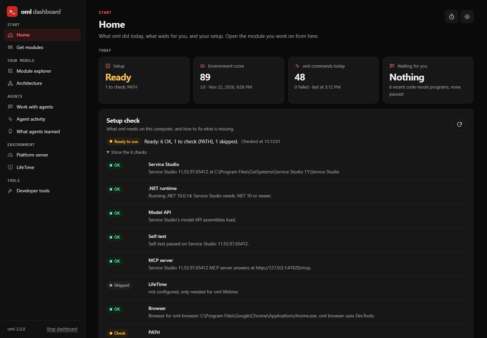

# Everything oml does

A short tour of every feature, grouped by job. Each command has more options: `oml <command> --help`, or [commands.md](skill/reference/commands.md). Every spec key: [spec.md](skill/reference/spec.md).

**Contents:** [I want to...](#i-want-to) · [Start a project](#start-a-project) · [Read a module](#read-a-module) · [Change a module](#change-a-module) · [Check and review](#check-and-review) · [Platform server](#platform-server) · [Service Studio and LifeTime](#service-studio-and-lifetime) · [Migrate to Reactive](#migrate-traditional-web-to-reactive) · [Running app](#look-at-the-running-app) · [Tests, data and mocks](#tests-test-data-and-mocks) · [Whole applications](#whole-applications) · [AI agents](#ai-agents) · [For people](#for-people) · [Packages and assets](#packages-and-assets) · [Setup](#setup-and-diagnostics) · [Safety](#safety) · [Not supported](#not-supported)

## I want to...

| Job | Command |
|---|---|
| Start working on an application | `oml create <project> --in <folder or .oap>` |
| See what a module holds | `oml inspect M.oml --own` |
| Know what an action or screen does | `oml describe M.oml <Element>` |
| Find which module owns an element | `oml find <Name> --in modules` |
| Add entities, actions, screens, REST APIs | `oml apply M.oml spec.json staged.oml` |
| Check a module before install | `oml check M.oml` |
| See what changed between two versions | `oml review before.oml after.oml` |
| Compare two published versions on the server | `oml review --server <Module> 4 published` |
| Get a module without opening Service Studio | `oml server pull <Module> --out M.oml` |
| Check the whole environment every evening | `oml server check` |
| Fix a Service Studio error | `oml explain-warning <id>` |
| Move a Traditional Web module to Reactive | `oml migrate plan old.oml --name NewModule` |
| See a screen the way users see it | `oml browser page <url>` |
| Find why a widget looks wrong | `oml browser look <url> <widget>` |
| Know what to test after a change | `oml test scenarios before.oml after.oml` |
| Publish after review | `oml publish <Module>` (asks first) |
| Deploy with LifeTime | `oml lifetime tag`, `oml lifetime deploy` (asks first) |
| Run many oml calls in one step | `oml code run -f program.py` |
| Map who calls what across apps | `oml map build <project>` then `oml map impact <element>` |

## Start a project

| Command | What it does |
|---|---|
| `create` | A project folder: `modules/`, `staged/`, `specs/`, `browser/`, `mocks/`, `scenarios/`, the skill, settings, project memory, the OutSystems docs and a setup check. With `--in`, the modules are copied in and the application map is built. |
| `config` | Project settings in `.oml/oml-config.json`: which steps run without a yes, which commands may run, which screen widths and themes to check, the author name. `oml config show` lists every setting. |
| `skill refresh` | Updates the project's `skill/` and `AGENTS.md` to this oml. |
| `hooks install` | Optional agent guards (see [AI agents](#ai-agents)). |

```powershell
oml config set ui.targets desktop    # no phone or tablet checks
oml config set checks.browser off    # no browser runs
oml config set author "Your Name"    # the name Service Studio shows on changes
```

Asking before install, publish, deploy and data deletion cannot be turned off.

## Read a module

All reads return compact JSON, sized for agents.

| Command | What it does |
|---|---|
| `inspect` | What a module holds: entities, actions, screens, blocks, references, timers, roles, processes, REST, site properties. `--in <folder>` reads many modules in one process. `--history` and `--changed-since` show who changed what and when. |
| `describe` | What one element does, in a few lines. `--css` gives styles, `--sql` the SQL. |
| `find` | Which module owns an element (own, referenced, producer). `--text "<words>"` ranks a module's elements by name, description and contents. |
| `query` | Read-only ModelQL questions, such as `"Root { Entities { Name } }"`. `--live` asks the module open in Service Studio. |
| `flow`, `tree`, `export` | One action as a graph, the object tree of one element, an element as JSON for tools. |
| `stats`, `header`, `expression` | Counts, the module header without loading the model, parse an expression. |
| `openapi` | Exposed REST APIs as OpenAPI 3.0.3, with placeholders to fill in. |

## Change a module

You describe the change in a JSON spec. `apply` writes a new staged file; the source never changes.

```powershell
oml spec check specs/change.json --module M.oml   # typos and bad names, in milliseconds
oml apply M.oml specs/change.json staged/M.oml
oml validate staged/M.oml --warnings
oml install staged/M.oml M.oml                     # only with zero errors; keeps a backup
```

What a spec can build:

| Area | Spec covers |
|---|---|
| Data | Entities, static entities, indexes, structures, CRUD wrapper actions, aggregates with joins and group by, SQL |
| Logic | Server, service and client actions, flows laid out the way Service Studio does it, timers, processes, roles, site properties |
| UI | Screens and blocks for Reactive, Mobile and Traditional Web; CSS for screens, blocks, emails and themes; `replaceWidgets` to change part of a screen |
| Integrations | Consume and expose REST APIs |
| Other | Translations, resources, long CSS or JavaScript from a file (`{ "file": "code/chart.js" }`); comments are removed, license notices stay |

More:

- `oml spec <key>` prints one spec key (15-60 lines). `oml spec --search "<words>"` finds the right key. `oml spec schema` gives VS Code autocomplete.
- 20 recipes in `skill/recipes/`: entity with CRUD, list and detail screens, search and paging, forms with validation, REST client, exposed API, email, BDD screen and more.
- `oml new` makes a new module, also from a template. `oml templates` lists the samples.
- `oml apply --batch` and `oml install --batch` handle many modules in one process.
- `oml translations export` writes Excel or ResX translation files.

## Check and review

| Command | What it does |
|---|---|
| `check` | 36 AI Mentor-like rules in seconds: queries in loops, screen queries without a row limit, server calls from client loops, inline SQL fed by input, `GetUserId()` from the client, secret-looking site properties, long or duplicated flows and more. On a module, a folder, an `.oap`, an application or a LifeTime team. HTML and JSON reports. |
| `check --init-rules` | A team rules file: turn rules on or off, set severities to match your AI Mentor, list ignored elements with a reason. |
| `check --baseline` | Marks findings `new` or `existing`; with `--fail-on`, only new findings fail CI. |
| `check --diff` | Findings fixed and introduced by a change. |
| `review` | Two versions of a module, matched by the model's keys, so a rename stays a rename. What changed in plain words, production-rule risks, new findings. JSON, Markdown for a pull request, HTML, or release notes for testers. |
| `review --prepare` | A packet for a blind logic review by a reviewer agent; `--import` checks its findings. |
| `architecture` | One zoomable HTML page of applications, modules, layers, dependencies and findings. `--publish-order` gives the order to publish in. |

`check` is a subset of AI Mentor from the module file alone, not a replacement. `review` does not find logic bugs; 0 findings does not mean the code is correct.

## Platform server

Reads the platform server directly, with Service Studio closed. Credentials come from `OML_SERVER_HOST`, `OML_SERVER_USER` and `OML_SERVER_PASSWORD`, set once as Windows user variables.

| Command | What it does |
|---|---|
| `server modules`, `server versions` | Every module (or one application's) and each module's versions. |
| `server pull` | One version of a module (published by default), or `--app` for every module of an application. It never overwrites; a second pull downloads only what changed. |
| `review --server` | Review two server versions in one step: a number, `published` or `latest`. |
| `server check` | End-of-day check of every published module: one environment score, per-module better or worse since the last run, history kept. Runs at "that's it for today" with the memory tidy. |

Publish stays in Service Studio. The usual flow is `server pull` → `apply` → review → publish in Service Studio.

## Service Studio and LifeTime

| Command | What it does |
|---|---|
| `pull` | Saves the module open in Service Studio to a file. |
| `publish` | 1-Click Publish through Service Studio's MCP server; `--in` with `--order` publishes many in order. Asks first. |
| `references` | Refresh All through Service Studio. Asks first. |
| `studio` | Is Service Studio reachable, which modules are open; focus or close a tab. |
| `lifetime` | LifeTime API v2: environments, teams, applications, download an `.oap`, tag, deploy, status, abort, continue. The token stays in environment variables. |

## Migrate Traditional Web to Reactive

| Command | What it does |
|---|---|
| `migrate plan` | Plan and specs for the old and the new module; screens translated or listed for manual work. Changes no module. |
| `migrate status` | By name: done, still to do, only in new, duplicates. |
| `migrate check` | Is the new module a correct copy: validation, action signatures, screen inputs and roles, block inputs, TODO stubs left. |

## Look at the running app

After you publish to DEV, agents can see what users see. Before a publish there is no visual check, so the agent reports "pending visual check".

| Command | What it does |
|---|---|
| `browser page` | Opens a screen, takes a screenshot and reports actions, inputs, tables, messages, layout, OutSystems calls (and slow ones), errors and accessibility. |
| `browser look` | One element: which block it is in, its box, computed styles, the CSS rule that wins and what it beats, what hides or covers it. Also hover, focus and dark theme. |
| `browser sweep` | The page at each supported width: overflow and the elements that cause it. |
| `browser try` | Preview planned CSS, HTML or JavaScript in the running page; nothing is saved. |
| `browser run`, `record` | Run steps like a manual tester (open, click, fill, expect, hand off to a person); record a script from your own clicks. |
| `browser diff` | What changed between two page snapshots. |
| `browser start`, `stop`, `raw` | Keep one browser open with its login; any DevTools call. |

## Tests, test data and mocks

| Command | What it does |
|---|---|
| `test scenarios` | What to test after a change: BDD per changed public action, scenarios and a browser script per screen. |
| `test bdd` | A spec for BDDFramework test screens of public server actions, in a separate test module. |
| `test data module` | The spec of a dev-only module that reaches your data through your own wrapper actions. |
| `test data create`, `update`, `check`, `cleanup` | Test data on DEV, BDD style; cleanup deletes exactly what the run created. |
| `mock` | Mock responses for every consumed API, for a mock server such as Castlemock. One persona keeps the same values across APIs. |

## Whole applications

`oml map build <project> --in <folder>` maps every module of a project once; rebuilds read only changed files. Then agents ask short questions without loading modules:

| Command | Answers |
|---|---|
| `map overview` | Applications, modules, sizes |
| `map uses <element>`, `map impact <element>` | Who uses it, what breaks if it changes |
| `map data <Entity>` | Who writes and reads it, which processes it starts, which APIs fill it |
| `map api <Api.Method>` | Who calls it, where its outputs go, what runs after it |

## AI agents

### Install the skill

The `skill/` folder holds instructions, rules, recipes and references. Keep it at the project root (`oml create` does it).

| Harness | Install |
|---|---|
| Codex, Cursor, Windsurf, Zed, VS Code (Copilot), Copilot coding agent, Jules, Aider, Junie, Amp, opencode, Warp | Copy `skill/AGENTS.md` to `AGENTS.md` at the project root. |
| GitHub Copilot (also Visual Studio) | Copy `skill/AGENTS.md` to `.github/copilot-instructions.md`. |
| Gemini CLI | Copy `skill/AGENTS.md` to `AGENTS.md` and set `"contextFileName": "AGENTS.md"` in `.gemini/settings.json`. |
| Claude Code | Copy `skill/` to `%USERPROFILE%\.claude\skills\outsystems-oml\`, or put `@AGENTS.md` in the project's `CLAUDE.md`. |
| Other agents | Give them `skill/AGENTS.md` or `skill/SKILL.md` as instructions. |

The default load (`SKILL.md` and `rules.md`) is about 2.8k tokens. Optional: a strong model leads cheap worker agents with [skill/architect.md](skill/architect.md).

### Fewer calls, fewer tokens

| Command | What it does |
|---|---|
| `code` | Code mode: one Python program runs many oml calls in parallel and returns only the answer. Reads and staged writes run at once; install, publish, references, pull, server and LifeTime calls pause until a person runs `oml code approve <id>`. Needs Python 3.9+. `.oml/codemode.json` adds other MCP servers, such as a task board. |
| `mcp` | An MCP server on stdio with three tools: `read`, `write` and `gated`. Service Studio's model loads once: 5 inspects take 13 ms instead of 9.4 s. |
| `batch` | Several commands in one process. |
| `--timings` | Milliseconds per phase on any command that loads a module. |

### Knowledge

| Command | What it does |
|---|---|
| `doc` | Short OutSystems rules by topic, written for small models (0.7k-2.3k tokens each): Reactive UI, OutSystems UI patterns, data, logic, security, REST, processes, architecture, warnings, migration, troubleshooting. |
| `doc --search` | The 3 most likely sections, spec keys, recipes, warnings or commands for any words. Local search, no model, no network. |
| `outsystems-docs fetch` | Downloads the OutSystems 11 docs (Markdown, about 15 MB); `doc --search --library` then answers platform questions. |
| `explain-warning` | Cause and fix of a validation message. `apply` already adds the fix to each new error. |
| `team-rules add` | Your company's own rules (naming, layers, Confluence pages as Markdown). They override oml's best practices, never the production rules. |

### Memory and learning

| Command | What it does |
|---|---|
| `memory` | Project memory: decisions, answers, traps, one fact per record in `.oml/memory/memory.log`, with a hash chain. Agents recall the best 3 records in their first read. Secrets are refused. `memory handoff` briefs the next agent; `memory dream` tidies at the end of the day. |
| `learn` | Where agents fail and retry, from the local usage log. `learn propose` turns it into trap records and draft company skills; a person accepts each, and can undo it. |
| `log summary` | Per command: count, failures, median time. The log stays on your machine; `OML_LOG=0` turns it off. |

### Hooks

`oml hooks install` (optional) stops agents from reading the large references whole, from editing `.oml` files and from calling the test-data API around oml, and gives each new session the project settings. Works in Claude Code, GitHub Copilot, Cursor, Codex and Gemini CLI. Costs no tokens.

### Give a good task

Say four things: the module file, what to build or change, which elements of other modules to use (`Module.Element`), and what the agent may not do.

```text
Module: C:\Work\Orders.oml. Add an entity Invoice (Number Text 20 mandatory,
Amount Decimal, IssuedOn Date) with Invoice_CreateOrUpdate and Invoice_Delete
server actions, and a Reactive list screen InvoiceList using the module's layout.
Stage the result and validate it. Do not install or publish.
```

```text
In C:\Work\Orders.oml, change Order_Save: before saving, call
Customers_CS.Customer_Validate with the order's CustomerId. The producer is
C:\Work\Customers_CS.oml. Show me the changed flow before you install anything.
```

One task per message works best. Split big features: data model, then logic, then screens.

### Skill checks

Before each release, `tests/skill-scan.ps1` scans `skill/` with [NVIDIA SkillSpector](https://github.com/NVIDIA/skillspector) (static rules, offline). `tests/skill-evals/` holds trigger and task evals; Claude Haiku 5.5 picked the skill in 14 and 15 of 15 trigger cases in the last two runs.

## For people

| Command | What it does |
|---|---|
| `menu` | Type `oml` in a terminal: everyday tasks in groups, each showing the command it runs, so you learn as you go. Agents never see it. |
| `dashboard` | A local web page with the same tools: today at a glance (setup, environment score, commands run, programs waiting for approval), module explorer, check and review reports, platform server scores over time with module versions to save or compare, code-mode programs, LifeTime, what agents ran and learned, developer tools. Listens on 127.0.0.1 with a random key; it never installs, publishes, deploys or approves. |
| `show-change` | An agent's change walkthrough on the dashboard: call stacks, flows, element links, the review, and comments to send back. Idea from [diffmap](https://github.com/tanishqkancharla/diffmap) (MIT). |
| `explorer-menu` | Right-click entries in Windows Explorer: fonts to WOFF2, optimize images, convert to ICO, trace to SVG, OpenAPI and dashboard for `.oml` files, architecture report for folders. No admin rights. |



## Packages and assets

| Command | What it does |
|---|---|
| `app list`, `extract`, `pack`, `check` | `.oap` and `.osp` packages; `check` finds missing producers. |
| `extension inspect`, `new` | `.xif` extensions. |
| `font woff2`, `font batch` | Fonts to WOFF2. |
| `image` | Convert, resize and shrink images; multi-size ICO; trace a logo to real SVG paths; optimize SVG with a pixel check. |

## Setup and diagnostics

| Command | What it does |
|---|---|
| `doctor` | Checks the setup and says what to fix. |
| `version`, `selftest` | The build and its check; the self-test runs by itself on a new Service Studio build. |
| `model-types`, `widget-types` | OutSystems API members on the installed build. |

Output is compact JSON on stdout. Exit codes: 0 ok, 1 model or validation failure, 2 usage or environment.

## Safety

Agents must assume everything in a module is already in production, with data and other modules using it. `apply` refuses, and prints the manual step instead:

- deleting an existing entity;
- renaming or deleting existing elements, parameters or attributes;
- breaking the signature of an existing public element;
- changing an existing attribute's type, length, decimals, mandatory or auto number setting;
- SQL that changes data (`DELETE`, `UPDATE`, `TRUNCATE`, `DROP`, `ALTER`, `MERGE`).

A server action that becomes public gets a warning, and the agent asks you. Elements created in the same spec stay fully editable. All 11 rules: [skill/rules.md](skill/rules.md).

| Step | Who |
|---|---|
| Read, write specs, apply, validate, check, review, browser | Agent |
| Install a staged file | Agent, after you confirm |
| Publish, Refresh All, server and LifeTime calls | Agent, after you confirm |
| Delete or rename existing elements, change existing attributes | You, in Service Studio |
| Final design touches, logic review | You |

## Not supported

Debugging, SOAP, downloading OutSystems UI, Traditional Web screen templates, and ODC (use the OutSystems MCP for ODC).
